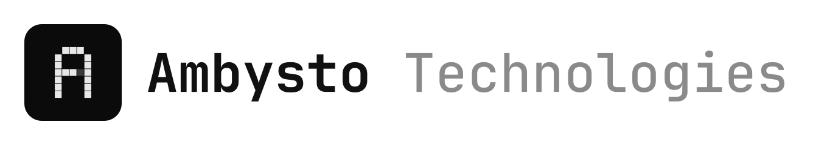

<picture>
  <source media="(prefers-color-scheme: dark)" srcset="docs/brand/ambysto-technologies-lockup-dark.svg">
  
</picture>

# Ambysto Kit

The shared foundation of the **Ambysto Pro Suite**, a set of native utilities that **measure first, change safely and are always reversible**. Each app needs the same hard parts: checking a license key, reading processes, deciding what is safe to touch, and showing one menu bar item across apps. The Kit holds them once, so every app gets them the same way.

- **Libraries:** a Swift package with license verification, brand tokens, the floating mini bar framework, suite discovery and the merged mini bar; and, for Windows, the .NET library `Ambysto.Kit.License`.
- **Suite apps:** the seven apps of the suite (table below). Steady does not use the Kit yet.
- **Suite-level docs:** strategy intents (`intent/`), the platform-neutral license spec, customer policies and market research.

Swift 6 package for macOS 14 or later; .NET library in `windows/`. Platform order: **every utility ships on macOS first, then Windows.**

## The suite

| App | What it does | Repo |
|---|---|---|
| Ambysto Optimer | See which apps are eating your Mac's memory, CPU and disk, and reclaim space safely. | `ambysto/ambysto-optimer` |
| Ambysto Steady | Stable Internet connection (monitor, diagnose, recover). | `ambysto/steady` |
| Ambysto Lean (formerly Space) | See where your disk space went, and reclaim it safely: disk map, large and old files, byte-identical duplicates, and uninstall with leftovers. | `ambysto/ambysto-space` |
| Ambysto DevBox | See what your development machine is running and holding on to: which processes listen on which ports and for which project, what your containers keep on disk, and which AI coding agents are busy. | `ambysto/ambysto-devbox` |
| Ambysto Power | Battery health, which apps use the most power, thermal state, and keep-awake schedules, measured, never forced. | `ambysto/ambysto-power` |
| Ambysto Tune | System tweaks as toggles that save the original value and restore it in one click. | `ambysto/ambysto-tune` |
| Ambysto Gate (formerly Guard) | See which app connects where, and allow or block it per app, without breaking your Mac. | `ambysto/ambysto-gate` |

## Is it for you?

Yes, if you build an Ambysto suite app and want the shared license check, process reading, file-safety gate or suite bar. No, if you want a finished app: the apps above are the products, the Kit is only what they stand on.

## Status

- Swift package: five libraries are built (license, process, safety, suite, UI) plus the owner-only `ambysto-license` tool. No tag exists yet; the first tag is planned as `v0.2.0`. Until it exists, apps pin a `main` commit (DevBox and Optimer pin revision `9e8c470`); after it, apps depend by semver tag (`from:`).
- Windows: `Ambysto.Kit.License` 0.1.2 is on GitHub Packages (tag `windows-v0.1.2`), and `Ambysto.Kit.Safety` (the Windows file-safety gate) is in `windows/src`. Until the production key exists, the verifier trusts no key and no Windows app ships on it.
- Open: the production license key (`TrustedKeys.production` and `Revocations` are empty), the first tag, and some owner-run proofs. `CLAUDE.md` lists them under "Open".

## What is in the repo

| Path | What |
|---|---|
| `Package.swift`, `Sources/` | The Swift package. Libraries: `AmbystoLicense` (offline license keys, P-256 signatures), `AmbystoProcess` (process reading over libproc and sysctl; it never sends a signal), `AmbystoSafety` (the file-safety gate; it never deletes or moves anything), `AmbystoSuite` (the suite bar's cross-app contract), `AmbystoUI` (Terminal theme, floating panel, global hot key, `SuiteParticipant`). Also the `ambysto-license` tool (`LicenseTool`, owner only, with the C target `KeychainACL`) and proof helpers (`ProcessProbe`, `SuiteBarDemo`). |
| `Tests/` | Swift tests for the five libraries. |
| `windows/` | The .NET 10 library `Ambysto.Kit.License` (namespace `Ambysto.Kit.Licensing`): the same license verifier, built from `docs/spec/license.md` and its vectors alone, never from the Swift code. A NuGet package on GitHub Packages from `windows-v*` tags. Also `Ambysto.Kit.Safety` (APS-24), built from `docs/spec/safety.md`. |
| `docs/spec/` | Platform-neutral specs and test vectors: `license.md`, `safety.md`, `process.md`, `suite-bar.md`, `intents.md`. |
| `docs/research/` | Market research. |
| `intent/` | Strategy intents and plans (intent → plan → build → verify). Start with `2026-10-09-ambysto-pro-suite.md`. |
| `scripts/` | Proof and check scripts (spec vectors, key sets, App Intents lint and metadata, socket and CPU comparisons, suite bar proofs). |
| `site/` | Suite landing page and customer policies (privacy, refund, terms). |
| `CLAUDE.md` | Guidance for AI agents working in the repo: rules, verify steps, open items. |

## Use it

Swift apps add the package and import the libraries they need (`AmbystoLicense`, `AmbystoProcess`, `AmbystoSafety`, `AmbystoSuite`, `AmbystoUI`). Until the first tag exists, pin a `main` commit and move it on purpose.

Windows apps reference `Ambysto.Kit.License` 0.1.2 or later from GitHub Packages. Installing needs a `read:packages` token on the machine. The library has no package reference of its own.

Apps cannot mint license keys. They test entitlement through their own verifier seam, never with a real key.

## Limits

- The libraries never delete, move, spawn or signal. Deleting and spawning exist only in `LicenseTool`.
- Public API serves the apps; a breaking change bumps the major version and every app's pin.
- The license tool is run only by the owner, never by an agent; no key material lives in the repo.
- The Windows libraries are built and tested on Windows.
- App Intents run only in a build signed with a team id.

## Check

Swift (macOS):

```sh
swift build -c release
swift test
python3 scripts/check-vectors.py
```

Windows, in `windows/`:

```sh
dotnet build -c Release Ambysto.Kit.slnx
dotnet test -c Release Ambysto.Kit.slnx
```

Both Swift and .NET production key sets must stay equal: `python3 -I scripts/check-key-sets.py`. The other proof scripts are listed under "Verify" in `CLAUDE.md`.

## Licence

Apache-2.0, see [LICENSE](LICENSE) and [NOTICE](NOTICE).
