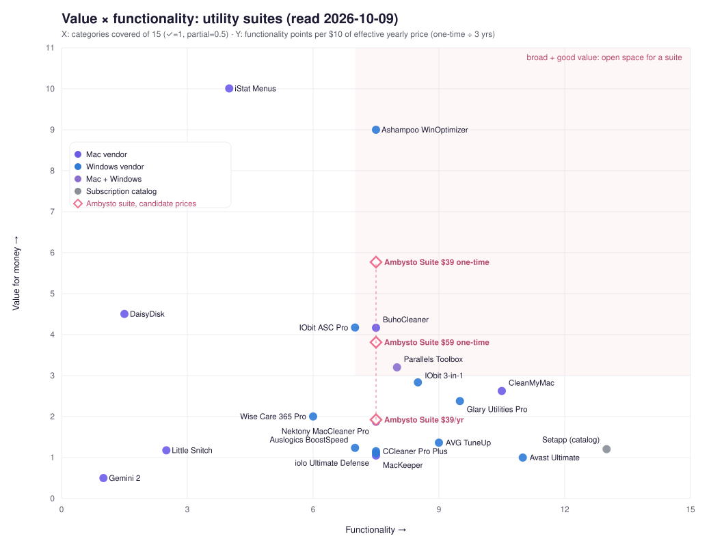

# Ambysto Pro Suite: market research on utility-suite vendors, bundle pricing and sales model

**Ticket:** APS-3 (`ambysto/ambysto-kit#2`). **Read on:** 2026-10-09. **Method:** the `bto-researchmarket` playbook, with five research agents:
- Mac vendors;
- Windows vendors;
- paying-user complaints;
- market size and money flows;
- company profiles (founding, ownership, funding, valuation).

The main session wrote the synthesis and did every computation.

## The decision this answers

> We need to know how utility-suite vendors structure, price and cross-sell bundles of single-purpose desktop utilities on macOS and Windows, and where a "measure first, change safely, always reversible" suite fits, **to decide Ambysto Pro Suite's bundle composition, price points and sales model.**

## Labels and limits

**Labels.** Every number carries one of three labels:
- **confirmed** means we opened the vendor's own pricing page, checkout or docs, a regulator's page, or an SEC filing.
- **secondary** means a third party reported it (press, forums, review sites).
- **vendor-claimed** means a company said it about itself (user counts, speed claims), whatever page it appears on.

**Limits.**
- **Region:** some fetches came from a Vietnam IP, so Parallels and CCleaner showed VND or VAT-inclusive USD, and Objective Development showed EUR. This is noted per row.
- **Blocked sources:**
  - macpaw.com/store and ccleaner.com returned 403, and we worked around them where possible.
  - Reddit, G2 and Capterra were unreachable, so **there is no Reddit evidence.**
  - Trustpilot content is what reviewers claim; we checked only that each review exists.

---

## 1. Key findings

1. **Real bundle discounts cluster at 20–60%. Headline discounts are inflated.**
   - IObit advertises its 3-in-1 at "-87%", but against what a buyer would otherwise pay it is about 50%.
   - Nektony's 1-Mac yearly bundle costs $0.10 *more* than its parts.
   - Rogue Amoeba is consistently about 20%. Avast and AVG Ultimate are about 59% at renewal.
2. **Auto-renewal is the biggest pain for paying users.** About 87 of about 275 low-star reviews we read involve unexpected renewals, cancellation friction or refused refunds. Next come:
   - paid users still nagged or upsold (~45);
   - license and activation failures (~30);
   - tools deleting or breaking things users wanted (~22).
3. **A broad suite with good value is open space** (chart in §4).
   - CleanMyMac sits at functionality 10.5 of 15, value 2.6. IObit ASC Pro is at 7.0 and 4.2; Parallels Toolbox at 8.0 and 3.2.
   - The only high-value products are *narrow* one-time apps: iStat Menus (10.0) and Ashampoo WinOptimizer bought one-time (9.0).
   - An Ambysto suite (Optimer + Steady + Space, 7.5) priced at **$39–59 one-time** lands at 3.8–5.8, above every suite plotted.
4. **No competitor ships network *stability* monitoring.** Windows vendors sell "Internet Boost" tweaks or VPNs; on Mac, iStat Menus and Parallels Toolbox show network usage. Steady's diagnose-and-recover angle is unique.
   - **Caveat:** we found no direct evidence that people pay for network tools. Users mock "booster" claims.
5. **The mainstream model is first-year discount, then full-price renewal** (Gen Digital brands, CCleaner), or a "permanent sale" with countdown timers (IObit, Wise, Dr.Buho).
   - Indie Mac vendors win praise with **one-time licenses**: DaisyDisk $9.99 for up to 5 Macs, iStat Menus $11.99.
6. **3 devices is the standard consumer tier** (IObit, CCleaner Pro Plus, Glary, Wise, Auslogics, Ashampoo). 5 and 10 are the "family" or top tiers.
7. **Trust is a lever.** Incumbents carry documented baggage:
   - the FTC's $16.5M Avast order (confirmed);
   - CCleaner's 2017 supply-chain compromise (confirmed, Cisco);
   - Microsoft Defender PUA entries for CCleaner and Driver Booster (confirmed);
   - fake-urgency pricing (confirmed on vendor pages).

   Microsoft's own PUA criteria now flag "exaggerated claims about your device's health" (confirmed).
8. **Free tools and the platforms set the floor.**
   - Mole is GPL-3.0 with 69.7k GitHub stars and dry-run plus Trash-first deletes. Stats is free. Microsoft PC Manager is free.
   - macOS keeps absorbing utilities: window tiling in Sequoia (confirmed); clipboard history in Tahoe (secondary).

---

## 2. Competitor prices

USD unless noted. "Effective $/yr" is what a buyer keeps paying: the renewal price where year one is discounted, or the displayed price where the discount looks permanent. One-time prices are divided by 3 years (assumption: roughly one major version per 3 years).

### Mac

| Product | Plan / seats | Price | Model | Label |
|---|---|---|---|---|
| CleanMyMac | Yearly; Plus yearly; monthly; Plus monthly (Mac App Store) | $39.99; $65.99; $9.99; $15.99 | subscription; one-time also offered, CMM5 one-time price not visible | confirmed (App Store) |
| CleanMyMac | Direct store | "Starting at $3.33/month" (≈ $39.96/yr if yearly ÷ 12) | 1, 2 or 5 Macs; 30% off other MacPaw apps | confirmed (macpaw.com); plan table blocked |
| Gemini 2 (MacPaw) | Yearly | $19.99 | subscription | confirmed (App Store) |
| ClearVPN (MacPaw) | 12 months | $44.99 | up to 6 devices | confirmed (App Store) |
| Setapp | Mac; Mac + iOS; Power User | $14.99 / $18.99 / $22.99 per month, or $8.99 / $11.24 / $13.49 per month billed yearly ($107.88 / $134.88 / $161.88 per yr) | subscription catalog, "260+" or "300+" apps (both figures on MacPaw pages) | confirmed (setapp.com structured data) |
| Parallels Toolbox | Mac or Windows | $24.99/yr (VAT-inclusive, VN view); 56 Mac tools | subscription, 14-day trial | confirmed (Cleverbridge cart) |
| Nektony MacCleaner Pro (6-app bundle) | 1 / 2 / 5 Macs | $39.95 / $53.28 / $93.24 per yr; one-time $85.95 / $129.95 / $199.95 | yearly or one-time; majors cost extra | confirmed |
| Nektony App Cleaner & Uninstaller | 1 Mac | $14.95/yr or $34.95 one-time | — | confirmed |
| Nektony Disk Space Analyzer | 1 Mac | $9.95/yr or $19.95 one-time | — | confirmed |
| iStat Menus 7 | Single; Family (5) | $11.99; $14.99 one-time; upgrade $9.99 | one-time | confirmed (Paddle price API used by bjango.com) |
| DaisyDisk | up to 5 Macs | $9.99 one-time; 30-day money-back | one-time | confirmed |
| BuhoCleaner | Yearly; lifetime | $17.99 (struck $39.99); $25.99 (struck $67.99) | "Autumn Sale", no end date | confirmed |
| MacKeeper | 1 Mac, 12 months | $71.40/yr ($5.95/mo); renewal not disclosed | subscription | confirmed (promo funnel) |
| Little Snitch | Single; Family | €59; €115 one-time | one-time | confirmed (EUR view) |
| Rogue Amoeba (audio; reference for bundle mechanics) | 7 apps | $29–99 one-time; upgrades 49–58% off | one-time, "one user on one or more Macs" | confirmed |

### Windows

| Product | Plan / seats | First year | Effective / renewal | Label |
|---|---|---|---|---|
| IObit Advanced SystemCare 19 Pro | 1 PC; 3 PCs | $16.77; $19.99 | renewal not published; "sale" with countdown | confirmed |
| IObit 3-in-1 (ASC Pro + Driver Booster Pro + Uninstaller Pro) | 3 PCs | $29.99 ($27.99 pop-up) | not published | confirmed |
| CCleaner Professional | 1 PC | $29.95 | $44.95/yr; cancel ≥ 35 days before renewal | confirmed (checkout, VAT note) |
| CCleaner Professional Plus (+ Recuva, Speccy, Mac, Android) | 3 devices | $39.95 | $64.95/yr | confirmed (checkout) |
| CCleaner Premium | 5 devices | $64.95 | $89.95/yr | confirmed (checkout) |
| Avast One with Cleanup Premium | 1 PC; 10 devices | $29.88; $34.68 | $65.99; $79.99/yr | confirmed |
| Avast Ultimate | 1 PC; 10 devices | $49.08; $69.48 | $109.99; $139.99/yr | confirmed |
| AVG TuneUp | 1 PC; 10 devices | $29.99; $34.99 | $65.99 (page JSON `futurePrice` $69.99); $79.99 (→ $84.99) | confirmed |
| AVG Ultimate | 10 devices | $59.88 | $149.99/yr | confirmed |
| Ashampoo WinOptimizer Pro 29 | 1 PC one-time; 3 PCs subscription | $25 (from $50); $14/yr | upgrade $16 | confirmed |
| Glary Utilities Pro | 3 PCs | $39.95/yr; 90-day money-back | — | confirmed |
| iolo System Mechanic Ultimate Defense | 10 devices | $67.93 (list $84.95) | renewal not shown | confirmed |
| Wise Care 365 Pro | 3 PCs | $29.96/yr ("Daily" discount) | not stated | confirmed |
| Auslogics BoostSpeed 14 Pro | 3 PCs | $56.62 with coupon (list $66.61) | — | confirmed |

---

## 3. Bundle mechanics: real discount vs. headline

Our own arithmetic, comparing against what a buyer would actually pay for the parts:

| Bundle | Real discount | Headline / note |
|---|---|---|
| IObit 3-in-1 | 1 − 29.99 / (19.99 + 22.95 + 16.77) = **49.8%** | "-87%" against seat-multiplied "list" prices nobody pays |
| CCleaner Pro Plus, renewal | 1 − 64.95 / (44.95 + 24.95 + 19.95) = **27.7%**; **51.8%** if you'd also buy Mac Pro | plus 3 seats |
| Avast Ultimate, 10 devices, renewal | 1 − 139.99 / 344.96 = **59.4%** | year one 69.7% |
| AVG Ultimate, 10 devices, renewal | 1 − 149.99 / 364.96 = **58.9%** | year one 72.0% |
| Rogue Amoeba Ultimate Podcast / Entire Lineup | **22.9% / 19.4%** | the larger set gets the smaller % |
| Nektony MacCleaner Pro, 1 Mac yearly | **−0.3%** (costs $0.10 more than the parts) | value is the extra core app; 2-Mac yearly 17.8%, 1-Mac monthly 28.3% |
| Objective Development Snitch Bundle | **3.5%** | family license vs 5 singles: 61% |
| Auslogics Essential Tools | **11.7%** | weakest in the set |
| MacPaw | no fixed bundle SKU; a standing **30% coupon** on other MacPaw apps for CleanMyMac buyers | cross-sell, not a bundle |
| Setapp Mac (yearly) vs CleanMyMac + Gemini + ClearVPN bought separately | $107.88 vs $104.97 | the catalog costs about the same as three apps |
| Bundle sites | BundleHunt about **86–89% off** list; StackSocial 87–92% "off" (inflated "suggested" values) | developer payout reported around $0.60 per license (one 2016 developer post) |

**Takeaways**

- **Seat-multiplied anchors are standard.** IObit and Nektony compute "was" prices as 1-seat price × seats.
- **Per-seat family pricing is where the real deals are.** Examples: iStat Menus family is 75% off five singles; LaunchBar family 66%; Little Snitch family 61%.

---

## 4. Value × functionality positioning



**How it is built** (reproducible: `assets/chart.py` and `assets/positioning.json`):
- **X, functionality:** coverage of 15 utility categories (✓ = 1, partial = 0.5). The categories are:
  1. system monitoring
  2. junk/cache cleanup
  3. disk visualization
  4. duplicates
  5. uninstaller with leftovers
  6. startup items
  7. malware
  8. privacy/browser cleanup
  9. network monitor / speed / VPN
  10. updater
  11. performance tweaks
  12. battery/power
  13. backup/recovery
  14. productivity
  15. firewall / per-app network control
- **Y, value:** functionality points per $10 of effective annual price, for the smallest standard plan (1 device where sold; IObit 3-in-1, Glary, Wise and Auslogics are sold as 3 PCs).
- **Assumptions:** one-time licenses are amortized over 3 years. Little Snitch converts €59 at 1.08 USD/EUR. Setapp's catalog coverage of 13 categories is assumed, not audited.
- Nektony MacCleaner Pro (7.5, 1.88) sits directly under the "Ambysto Suite $39/yr" marker.

**What the chart says**

- **Suites cluster at value 1–3.** The subscription heavyweights sit at the bottom right: Avast Ultimate 11 / 1.0, Setapp 13 / 1.2, AVG TuneUp 9 / 1.4, CleanMyMac 10.5 / 2.6.
- **The high-value corner holds only focused one-time apps.**
- **The shaded area (broad and good value) has no competitor.**
- **Ambysto Suite (Optimer + Steady + Space = 7.5) at candidate prices:**
  - $39/yr → 1.9: middle of the pack, no advantage.
  - $59 one-time → 3.8: above every suite plotted.
  - $39 one-time → 5.8: clearly in the open space.
- **X grows with future apps.** Power (battery), Clip (productivity) and Guard (firewall) would add categories 12, 14 and 15, moving the suite to about 10.5, CleanMyMac's breadth.

| Product | Functionality | Effective $/yr | Value |
|---|---|---|---|
| iStat Menus | 4.0 | 4.00 | 10.0 |
| Ashampoo WinOptimizer (one-time) | 7.5 | 8.33 | 9.0 |
| *Ambysto Suite, $39 one-time (hypothesis)* | *7.5* | *13.00* | *5.8* |
| DaisyDisk | 1.5 | 3.33 | 4.5 |
| BuhoCleaner | 7.5 | 17.99 | 4.2 |
| IObit ASC Pro | 7.0 | 16.77 | 4.2 |
| *Ambysto Suite, $59 one-time (hypothesis)* | *7.5* | *19.67* | *3.8* |
| Parallels Toolbox | 8.0 | 24.99 | 3.2 |
| IObit 3-in-1 | 8.5 | 29.99 | 2.8 |
| CleanMyMac | 10.5 | 39.99 | 2.6 |
| Glary Utilities Pro | 9.5 | 39.95 | 2.4 |
| Wise Care 365 Pro | 6.0 | 29.96 | 2.0 |
| *Ambysto Suite, $39/yr (hypothesis)* | *7.5* | *39.00* | *1.9* |
| Nektony MacCleaner Pro | 7.5 | 39.95 | 1.9 |
| AVG TuneUp | 9.0 | 65.99 | 1.4 |
| Auslogics BoostSpeed | 7.0 | 56.62 | 1.2 |
| Setapp (catalog) | 13.0 | 107.88 | 1.2 |
| Little Snitch | 2.5 | 21.24 | 1.2 |
| CCleaner Pro Plus | 7.5 | 64.95 | 1.2 |
| iolo Ultimate Defense | 7.5 | 67.93 | 1.1 |
| MacKeeper | 7.5 | 71.40 | 1.1 |
| Avast Ultimate | 11.0 | 109.99 | 1.0 |
| Gemini 2 | 1.0 | 19.99 | 0.5 |

---

## 5. What paying users complain about

These come from about 275 Trustpilot 1–2★ reviews across 9 brands plus about 230 Hacker News comments. The counts are reviews we read, not a statistical sample.

| Theme | Count | Examples | What it means for Ambysto |
|---|---|---|---|
| A. Auto-renewal, cancellation, refunds | ~87 | Parallels (~14 of 20 1★), CCleaner (renewal "tripled"), MacKeeper (cancel 14 days early), MacPaw | **No auto-renew**: a perpetual offline license, plus a refund window stated upfront |
| B. Paid users still nagged or upsold | ~45 | CleanMyMac asks paying users to start trials; CCleaner shows ads to premium users; AVG, IObit | **Pro means zero upsell** (WinRAR rule: the reminder applies to Free only) |
| C. Deleting or breaking wanted things | ~22 | CCleaner removed VC++ runtimes; MacKeeper duplicate finder re-enabled after an update; IObit deleted emails | Our safety gate, Trash by default, in-use checks, never auto-enabling destructive features |
| D. License and activation failures | ~30 | Setapp fails offline; Ashampoo keys lost after reinstall; Toolbox doesn't see renewals | Signed offline key file plus self-serve transfer (AO-5) |
| E. "Lifetime" upgrade betrayal | 6 | CleanMyMac X lifetime holders pay for v5; MacKeeper | State exactly what lifetime covers (`updatesUntil`) |
| F. Bloat, bundled installers, PUA flags | ~18 | CCleaner bundling Avast; IObit installers | No bundled offers, ever |
| H. Paying for tools never used | — | Setapp cancellers; Parallels split Toolbox into packs (2018) | Sell à la carte **and** a suite |
| I. Bots instead of human support | ~40 | MacPaw, CCleaner, IObit | Human support is a differentiator (Nektony is praised for it) |
| K. "Booster" claims without evidence | — | IObit "3× browser"; AnandTech: Ashampoo Internet Accelerator is "snake oil" | Steady must *measure and explain*, never promise speed |

**What users praise:**
- one-time licenses that keep working (DaisyDisk, iStat Menus);
- seeing which app misbehaves (iStat Menus);
- thorough uninstall and human support (Nektony, 4.9★ from 264 reviews);
- finding developer caches (CleanMyMac found 57.6 GB of Xcode caches).

---

## 6. Market size: TAM, SAM and SOM (our arithmetic; argue with the assumptions)

Analyst "PC optimization" market figures range from **$0.36B to $13.64B (about 38×)** with no visible methodology. **We do not use them** (see §9). Our chain is built bottom-up.

**Mac**

```
Active Macs (2026)    ≈ 100M (Apple, 2018 — secondary quote of Tim Cook) × 1.03^8 (assumed +3%/yr net growth)
                      ≈ 127M → use 125M (range 110–140M)

Paying Mac utility buyers:
  CleanMyMac revenue  ≈ $90.2M (MacPaw 2024, confirmed: UK group accounts) × 80% (CleanMyMac share, vendor-claimed via press) = $72M
  ÷ $40 per paying user per year (assumption ≈ App Store yearly $39.99) ≈ 1.8M paying CleanMyMac users
  ÷ 40% (assumed CleanMyMac share of paid Mac utility spend) ≈ 4.5M paying buyers ≈ 3.6% of 125M

TAM_mac  = 125M × 3.6% × $40/yr ≈ $180M/yr
```

**Windows**

```
Active Windows PCs  ≈ 1.0B (assumption: Microsoft's "1.4B monthly active devices" is a 2022 figure that includes non-PC devices)
Paying rate          = 1.5% (assumption: lower willingness to pay, free Microsoft PC Manager, Defender PUA pressure)
TAM_win  = 1.0B × 1.5% × $30/yr (assumption: Windows price points) ≈ $450M/yr
```

**Total and Ambysto's slice**

```
TAM ≈ $630M/yr

SAM (macOS first, next 24 months)
    = TAM_mac × 30% (developers, creators and power users who value safe, measured tools and network/dev features)
              × 70% (reachable through English, direct web sales via a merchant of record; excludes App Store-only buyers)
    = $180M × 0.30 × 0.70 ≈ $38M/yr

SOM (12 months after Pro launch)
    = SAM × 0.25% ≈ $95K ≈ 2,400 suite-equivalent buyers at $39
    Funnel check: at 3–5% Free → Pro conversion, that needs ≈ 48K–80K Free users.
```

Two caveats:
- The Mac paying rate is triangulated from one vendor's revenue and an assumed leader share, so the 40% share is the assumption to challenge.
- Windows is a later SAM; it is not counted until the Windows apps exist.

---

## 7. Money flows and platform rules (context)

**Deals and companies**
- Gen Digital (Norton + Avast, including CCleaner) completed the Avast merger on 2022-09-12 (confirmed).
- Gen's growth money went into fintech: MoneyLion, acquired 2025-04-17, lifted Trust-Based Solutions from $759M to $1,661M (confirmed, 10-K FY26).
- Gen reports about 500M users and about 79M paid (15.8%) across its whole portfolio (vendor-claimed, 10-K).
- MacPaw:
  - revenue was $90.2M in 2024 (confirmed: UK group accounts; see §7b);
  - it is pivoting "AI-first" (secondary);
  - it closed Setapp Mobile (secondary);
  - it opened single-app sales on Setapp: developers get 85% of subscriptions and 75% of one-time sales (confirmed, docs).
- Parallels has "more than one million customers" and stays with KKR after Corel's split (confirmed, 2026-02-26).

**Platform rules**
- Mac App Store guideline 2.4.5 forbids root escalation and license keys and requires sandboxing (confirmed). Utilities like ours must sell **direct**.
- Paddle charges 5% + 50¢ per transaction (confirmed).
- Microsoft Store: 85/15 split, or keep 100% with your own commerce (confirmed, 2021).
- FTC: Restoro and Reimage paid $26M over fake "repair" pop-ups (confirmed, 2024). Defender's PUA criteria flag alarming health claims (confirmed).

---

## 7b. Company profiles

Gathered by a fifth agent using filings and the companies' own pages. MacPaw files audited group accounts in the UK (**MacPaw Family Ltd**, Companies House 11596716), so its numbers below come from a filing rather than from interviews.

| Company | Founded | HQ | Ownership | Funding, deals, valuation | Scale disclosed | Label |
|---|---|---|---|---|---|---|
| MacPaw (CleanMyMac, Setapp) | 2008 | Kyiv; London holding, Cyprus operating company | **Bootstrapped**; founder ≥ 75% | No rounds. Bought The Unarchiver (2017, undisclosed) | **Revenue $90.2M (2024, +6.2%)**; net loss −$13.15M after an $11.3M building impairment; SaaS line $13.15M ≈ Setapp (inferred) | confirmed (filing) |
| Gen Digital (Norton, Avast, AVG, CCleaner) | Symantec lineage | Tempe, AZ and Prague | Public, Nasdaq: GEN | Avast at $8.1–8.6B **equity** value (closed 2022); MoneyLion ~$1B (2025); market cap ≈ $13.6B (598.6M shares × $22.75 close on 8 Oct 2026) | Revenue $5.0B (FY26); ~79M paid of ~500M users; ~3,900 staff | confirmed; share price secondary |
| Avast | 1988 | Prague | Gen subsidiary | CVC 2014 at $1B; LSE IPO 2018 at $3.23B; bought AVG ~$1.3B (2016) and Piriform (2017, undisclosed) | Revenue $941M (2021, last standalone) | confirmed |
| AVG | 1991 | Amsterdam (registered) | Gen subsidiary | NYSE IPO 2012 at $16/share; acquired ~$1.3B | Revenue $428M (2015) | confirmed |
| Piriform (CCleaner) | 2004 | London | Gen subsidiary | Avast 2017, undisclosed; UK entity in solvent liquidation since 2024 (intra-group, by our reading) | "2.5B downloads" | confirmed / vendor-claimed |
| Parallels | 1999 | Schaffhausen, CH (legal seat) | PE: KKR funds | Corel bought it (2018), KKR bought Corel (2019), Corel split (2026): all undisclosed | "1M+ customers" | confirmed; founding year secondary |
| IObit | 2004 | Not published (Hong Kong law) | Private (Both Talent International Ltd) | None disclosed | "100M+" and "500M+ users" on one page | confirmed / vendor-claimed |
| Ashampoo | 1999 | Rastede, Germany | Private, founders | None | "Team of just 55" | confirmed / vendor-claimed |
| Clario Tech (MacKeeper) | 2009 (ZeoBIT) | Dubai | Private | ZeoBIT → Kromtech (2013) → Clario (2019), undisclosed | "65M+ downloads" | owner confirmed; history secondary |
| iolo technologies | 1998 | Los Angeles | RealDefense brand | Phoenix Technologies (2013); RealDefense (~2020, unconfirmed) | — | partly confirmed |
| Raycast | 2020 | Remote; UK company | VC-backed | Seed $2.7M (Accel), A $15M (Accel, Coatue), B $30M (Atomico, Sep 2024) ≈ $47.7M | "40 folks" | confirmed |
| Nektony | 2011 | Odesa | Independent | None | "11.8M+ installations" | confirmed / vendor-claimed |
| Rogue Amoeba | 2002 | Boston | Privately held | None | 12 people profiled | confirmed |
| Objective Development | 2004 (predecessor 2003) | Vienna | Private GmbH | None | — | confirmed |
| Bjango | 2005 | Australia | Self-funded | None | — | confirmed |
| Software Ambience (DaisyDisk) | 2008 | Kyiv | Independent | None | — | confirmed |
| Dr.Buho | 2020 | Chengdu | Not stated | None | "1,000,000+ users" | confirmed / vendor-claimed |
| Auslogics | 2008 | Sydney | Private | None | "50M+ downloads" | confirmed / vendor-claimed |
| BundleHunt | 2010 | Delaware LLC, remote | Self-funded | None | "2,450+ deals" | confirmed / vendor-claimed |
| StackCommerce | ~2011 | California | PE: TPG majority (2021) | $800K seed (2012) | ~$80M revenue (2020, press) | mostly secondary |

**What it means for Ambysto.**
- **The big money came from consolidation into security companies.** Avast, AVG and CCleaner all ended up inside Gen.
- **The Mac utility makers that last are small, self-funded and profitable on one-time licences.**
- **MacPaw is the bootstrapped outlier** at about $90M. Even so, it posted a loss in 2024 while investing in AI products.

## 8. Recommendation (hypotheses to validate, not decisions)

1. **Model.** Perpetual offline license, **no auto-renewal**, including **1 year of updates** (`updatesUntil` in the AO-5 key). After that, an optional update renewal at about 50% (Rogue Amoeba upgrades run 49–58%). The Free tier stays forever (WinRAR model).
   - *Evidence:* auto-renewal is complaint theme A (the largest); "lifetime" upgrade betrayal is theme E; one-time licenses are praised.
2. **Price points to test.**
   - **Single app Pro:** $19.99 one-time (test range $12.99–24.99). Anchors: iStat $11.99, DaisyDisk $9.99, Ashampoo $25, Nektony one-time $34.95.
   - **Pro Suite** (Optimer + Steady + Space): **$39 launch / $49 regular** one-time. That is a 35–18% discount against $59.97 of singles, and value 5.8 / 4.6 on the chart, above every suite.
   - When the suite reaches 5+ apps, keep one suite price around **$59–69**, so the discount deepens toward the 40–60% the big suites show.
   - **Seats:** up to 3 Macs per personal license (industry standard). Family: 5.
   - **Education / Build to Own cohort:** 30% (MacPaw's level).
   - **Refund:** 30 days, no questions (industry norm; it beats IObit's conditional 60).
3. **Composition.**
   - Ship Optimer + Steady + Space as the first suite.
   - Fill low-coverage categories next: startup items (fold into Optimer), battery (Power), productivity (Clip; Sherlock risk from macOS Tahoe's clipboard history), firewall (Guard, after Developer ID).
   - **Skip driver/app updaters on Windows.** That is the area Defender flags and users distrust.
4. **Positioning copy:** *"Measure first. Change safely. Always reversible. No auto-renew. No telemetry. Pro means no upsell."* Each claim answers a documented complaint theme.
5. **Channels.**
   - **Direct** through a merchant of record (Paddle or similar; payment ticket APS-5).
   - **Setapp** later as an extra channel, after reading its usage-weighted membership payout.
   - **Avoid bundle sites** except as a deliberate launch spike. They sell at about 86–92% off and could undercut the brand.
6. **Validate before pricing is final**, cheapest first:
   - the landing page plus a waitlist with a price toggle (AO-12);
   - 5 interviews with developers and creators;
   - a pre-sale to the Build to Own cohort at the education price.

---

## 9. Numbers we refuse to print as facts (untraceable or self-contradictory)

| Claim in circulation | Why refused |
|---|---|
| "Mac has 120–150M users" | Apple's only Mac-specific figure is 100M (2018). Everything newer is extrapolation. We use our own labelled assumption instead. |
| "1.4B Windows devices" as a PC count | It is a 2022 figure, unchanged since. "Monthly active devices" may include non-PC devices. A 2025 blog first said "over 1 billion", then was edited. |
| PC-optimization market of $0.36B–$13.64B | SEO-report publishers with no visible methodology. Internal errors: a CAGR that doesn't match its endpoints; two figures 10× apart on one page; defunct companies listed as key players. |
| CCleaner 5.33 infected "2.27M" users | Not in Cisco Talos's post (Cisco says "could affect millions"). Secondary sources also give 2.5M. |
| CCleaner "2.5B downloads" | Affiliate sites only. The last sourced milestone is 2B (2016 PR), and downloads are not users. |
| IObit "100M+ / 200M+ / 500M+ users" | Three conflicting figures on IObit's own site. |
| MacPaw revenue $34.8M (Latka) / $138.6M (StartupHub) | Model estimates that contradict the $90.2M in MacPaw's UK group accounts. |
| MacPaw "$2B valuation" | An IPO target the founder named in interviews. No round, deal or market price is behind it. |
| MacPaw "loss over $10M / 2023 profit $3.1M" (press) | Those are total-comprehensive-income lines. The filing's loss and profit for the year are −$13.15M and +$7.53M. |
| MacPaw "gross margin 28.5%" | The filing's own narrative says this, but its P&L gives 73.9%. |
| KKR–Corel "over $1B", Piriform "~$50M", Avast "$8.6B enterprise value" | No release discloses these figures. Avast's $8.1–8.6B is equity value. |
| CCleaner revenue "$19.8M", Glarysoft "$3M", any Latka/Growjo/Owler figure | Model estimates. Untraceable by definition. |
| Setapp "1M users (2019)", current subscriber count | No MacPaw source. The last disclosed figure is 15,000 subscribers (2018). |
| "CleanMyMac 20M+ downloads", "Parallels $100M+ revenue" | No original source. |
| Setapp survey: "83% of Mac users paid for software last month", "$139/yr" | Self-selected vendor survey, partly Setapp users. Setapp itself warns spending may be overstated. **Not used as a conversion rate.** |
| Setapp "went from $10 to $30+" (Sep 2025) | Only an HN comment. The June 10, 2026 price update is confirmed, the magnitude isn't. |
| CleanMyMac direct-store price tables (various $39.95–$195.95 figures) | Store returned 403. Third-party figures conflict. |
| Setapp catalog size | "250+", "260+" and "300+" all appear on MacPaw pages. |
| Bundle-site vendor share "50%" | A 2021 forum post, since removed. BundleHunt says only "Fair Revenue Share". |
| IObit "list" prices ($224.75 etc.), MacKeeper "77% off", Dr.Buho bundle "was $137.99" | Anchors that don't add up or that no buyer pays. Dr.Buho's own struck prices sum to $127.97. |
| Parallels Toolbox "48 Windows tools" | The page itself lists 42 Windows-tagged tools. |

---

## 10. Corrections the main session made to the agents' raw output

These checks are part of the playbook: there was at least one agent error to find.

1. **CleanMyMac break-even** (complaints agent): "$89.99 one-time ÷ $39.99/yr = 2.25 years". The $89.99 SKU is the **legacy CleanMyMac X** one-time purchase; no CleanMyMac 5 one-time price was visible. The comparison mixes versions and is dropped.
2. **Parallels Toolbox price** (complaints agent): "price not shown". The Mac agent read **$24.99/yr** in the vendor's Cleverbridge cart (VAT-inclusive, VN view). We use that.
3. **Setapp annual price** (complaints agent): "≈ $107.93 if 40% applies". The confirmed annual price is $8.99/mo × 12 = **$107.88**.
4. **Resource monitoring** (Windows agent): "real resource monitoring only in Wise and Auslogics". The same agent's IObit table marks ASC's Performance Monitor ✓. We count IObit too.
5. **Setapp revenue-share example** (Mac agent, checked): Setapp's docs say ≈ $2.24, but ($9.99 × 70%) × 10/31 = $2.26. The agent was right and the vendor docs have a small error.

---

## Sources

Each agent's raw report, with every URL and its confirmed/unverified label, is preserved in the session. The key primary sources:
- **Mac App Store:** CleanMyMac, Gemini 2, ClearVPN.
- **Pricing pages:** setapp.com/pricing (structured data); Setapp developer docs; buy.parallels.com carts; nektony.com buy pages; checkout.paddle.com price API (iStat Menus); daisydiskapp.com; drbuho.com; obdev.at/shop; rogueamoeba.com store.
- **Windows vendors:** iobit.com store and refund policy; secure.ccleaner.com checkouts; avast.com and avg.com en-us pages (embedded price JSON); ashampoo.com; glarysoft.com; iolo.com; wisecleaner.com; auslogics.com.
- **Regulators and filings:** FTC (Avast 2024, Restoro/Reimage 2024); Cisco (CCleaner 2017); Microsoft Defender threat encyclopedia; SEC filings (Apple 8-K, Gen Digital 10-K FY26).
- **Platform pages:** Apple App Store Review Guidelines; Microsoft Store and Defender criteria.
- **Reviews and data:** Trustpilot low-star filters; Hacker News (Algolia API); StatCounter.
